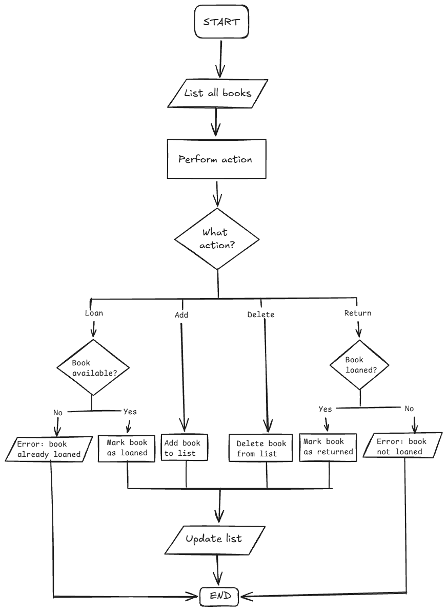

# Specification – BookKeeper

## 1 The assignment in my own words
A library system that keeps track of which books the library has and which of them are loaned out, and by whom.
The librarian adds, lists and deletes books. Library users see the available books, loan them, see their own loans and return them.
The domain logic is built with TDD and then made available through a REST API.
Assignment 2: the API runs in Docker, stores the books in PostgreSQL through EF Core, and the whole system starts with Docker Compose (API, PostgreSQL, pgAdmin and Traefik), with a health check. No new functionality.
Assignment 3: the API provides registration and login. It creates users, hashes and checks passwords, and returns a JWT after a successful login. The token identifies the user and their role, and limits what they can see and do.
Delivered as a GitHub repo with tests and a README.

## 2 Requirements
Main flow (assignment 3):
A user creates an account, chooses to be a librarian or library user, and logs in.

If librarian:
Adds a book, sees it in the list, deletes it.

If library user:
Sees an available book in the list, loans it, sees a list of their loans, returns it.

Core (MUST):
- Add a book               ✔ AddBook_ValidBook_AddsBookToLibrary, PostBooks_ValidBook_ReturnsCreatedBook
- List the books           ✔ GetBooks_AfterBookAdded_ReturnsOkWithList
- List available books     ✔ GetAvailableBooks_OneIsLoaned_ReturnsOnlyTheOther
- List own loans           ✔ GetLoans_TwoUsers_ReturnsOnlyOwn, GetBooksLoans_TwoUsers_ReturnsOnlyOwn
- Loan a book              ✔ LoanBook_ExistingBook_BecomesLoaned, LoanBook_ExistingBook_SetsLoanedByUserId, PatchBooksLoan_ExistingBook_ReturnsNoContent
- Return a book            ✔ ReturnBook_ExistingLoanedBook_BecomesNotLoaned, ReturnBook_LoanedBook_RemovesItFromGetLoans, PatchBooksReturn_LoanedBook_ReturnsNoContent
- Delete a book            ✔ DeleteBook_ExistingBook_RemovesBookFromLibrary, DeleteBooks_ExistingBook_ReturnsNoContent
- REST API                 ✔ BooksApiTests and AuthApiTests (every line in api.md)

Users and login (assignment 3):
- Register a user                        ✔ PostAuthRegister_NewUser_ReturnsCreated
- A username can only be used once       ✔ PostAuthRegister_TakenUsername_ReturnsConflict
- The password is stored as a hash       ✔ PostAuthRegister_NewUser_StoresOnlyHash
- Log in and get a JWT                   ✔ PostAuthLogin_ValidCredentials_ReturnsToken
- A wrong password gives no token        ✔ PostAuthLogin_WrongPassword_ReturnsUnauthorized
- The token identifies the user          ✔ GetAuthMe_WithToken_ReturnsUsername
- No valid token gives 401               ✔ GetBooks_WithoutToken_ReturnsUnauthorized

Rules:
- Can't loan a book that's already loaned out   ✔ LoanBook_AlreadyLoaned_ThrowsException, PatchBooksLoan_AlreadyLoaned_ReturnsConflict
- Can't return a book that hasn't been loaned   ✔ ReturnBook_NotLoanedBook_ThrowsException, PatchBooksReturn_NotLoaned_ReturnsConflict
- Can't delete a loaned out book (assignment 3) ✔ DeleteBook_AlreadyLoaned_ThrowsInvalidOperationException, DeleteBooks_LoanedBook_ReturnsConflict

Role rules (assignment 3):
- The role is Librarian or LibraryUser                ✔ PostAuthRegister_InvalidRole_ReturnsBadRequest
- Only one librarian can be created                   ✔ PostAuthRegister_SecondLibrarian_ReturnsConflict
- Only the librarian can add or delete books          ✔ PostBooks_NotLibrarian_ReturnsForbidden, DeleteBooks_NotLibrarian_ReturnsForbidden
- Only library users can loan, return and see loans   ✔ PatchBooksLoan_NotLibraryUser_ReturnsForbidden, PatchBooksReturn_NotLibraryUser_ReturnsForbidden, GetBooksLoans_NotLibraryUser_ReturnsForbidden
- The librarian sees every book                       ✔ GetBooks_Librarian_ShowsLoanedBooks
- A library user only sees available books            ✔ GetBooks_LibraryUser_DoesNotShowLoanedBooks

Ownership rules (assignment 3):
- A user only sees their own loans         ✔ GetLoans_TwoUsers_ReturnsOnlyOwn, GetBooksLoans_TwoUsers_ReturnsOnlyOwn
- A user can't return another user's loan  ✔ ReturnBook_OtherUsersLoan_ThrowsUnauthorizedAccessException, PatchBooksReturn_LoanedByOtherUser_ReturnsForbidden

## 3 Flow


A user registers with a role and logs in. A librarian sees all books and adds or deletes one. A library user sees the available books, loans one, sees their loans and returns it.

## 4 Interface
```
BookService
- IReadOnlyList<Book> GetBooks()                   -> all books
- IReadOnlyList<Book> GetAvailableBooks()          -> books that are not loaned (LoanedByUserId is empty)
- Book AddBook(string title, string author)        -> new book, not loaned
- void LoanBook(Guid id, Guid userId)              -> book is loaned by the user (LoanedByUserId = userId)
                                                      already loaned: InvalidOperationException
- IReadOnlyList<Book> GetLoans(Guid userId)        -> the books the user has loaned
- void ReturnBook(Guid id, Guid userId)            -> book is available (LoanedByUserId is empty)
                                                      not loaned: InvalidOperationException
                                                      another user's loan: UnauthorizedAccessException
- void DeleteBook(Guid id)                         -> book is removed
                                                      book is loaned: InvalidOperationException
  Unknown id in loan, return and delete: InvalidOperationException

AuthService
- User Register(string username, string password, string role) -> new user, with the password hashed by BCrypt
                                                      username taken or a librarian exists: InvalidOperationException
                                                      unknown role: ArgumentException
- string Login(string username, string password)   -> JWT with the user id (sub), the username and the role
                                                      wrong username or password: UnauthorizedAccessException

Book: Id (Guid), Title (string), Author (string), LoanedByUserId (Guid?, empty when the book is available), IsLoaned (bool, true when LoanedByUserId has a value)
Example: 3f2c..., "The Great Gatsby", "F. Scott Fitzgerald", 2a6f..., true

User: Id (Guid), Username (string, unique), PasswordHash (string), Role (Librarian or LibraryUser)
```

Dependencies:
- BookService depends only on IBookRepository. EfBookRepository (BookKeeper.Infrastructure) stores the books in PostgreSQL and is used by the API. FakeBookRepository (BookKeeper.Core) keeps them in memory and is used by the tests.
- AuthService depends only on IUserRepository. EfUserRepository stores the users in PostgreSQL and is used by the API. FakeUserRepository keeps them in memory and is used by the API tests.

## 5 Test list
- [x] A new book can be added
- [x] A book can be marked as loaned
- [x] An already loaned book cannot be loaned
- [x] A book can be marked as returned/made available
- [x] A book cannot be returned if it wasn't already loaned
- [x] A book can be deleted
- [x] A loan registers loanee
- [x] A loaned book can't be deleted
- [x] List only your own loans
- [x] The list of available books won't show loaned books
- [x] User can't return other's loans
- [x] A returned book is no longer in the user's loan
- [x] A user can register, and only the hash of the password is stored
- [x] A user can log in and gets a token. A wrong password gives 401
- [x] Only known roles, and only one librarian
- [x] The book endpoints give 401 without a token, and 403 with the wrong role
- [x] The librarian sees every book, and a library user only the available ones

Manual checks (assignment 3, against the API in Docker Compose with BookKeeper.Api.http):
- [x] The whole flow works against PostgreSQL: register, log in, send the token, add a book, loan it, see it in my loans, return it
- [x] A second library user does not see the loan, and gets 403 when returning it
- [x] In pgAdmin: Users has only the hash in PasswordHash. While the book is loaned, LoanedByUserId in Books is the user's id. After the return it is NULL

Later questions:
- [x] Can a user loan several books?
- [x] Can the library add multiple copies of the same book?

## 6 Questions, assumptions and decisions
- Clarified: The repo will be used for the coming assignments
- Assumption: "4–5 tests" in the grading means domain tests only (part 2 of the assignment asks for 4–5 tests for the domain logic)
- Decision: 6 domain tests instead of 4–5 in assignment 1, because each of the two rules has its own test. Assignment 3 added 6 more for the new rules
- Decision: Returning a book that is not loaned gives an error (InvalidOperationException)
- Decision: Loaning several copies of the same book is not essential to the MVP. It might be added later
- Clarified: The instructor requires IBookRepository and FakeBookRepository before assignment 2, added as a refactor
- Decision: No handling of storage failure. If the database is down, the API returns 500, and `/health` reports `Unhealthy`

- Decision (assignment 2): EF Core with PostgreSQL, in its own project (BookKeeper.Infrastructure), so BookKeeper.Core does not know about the database
- Decision (assignment 2): BookService calls IBookRepository.Update after loan and return, so the change is saved in the database
- Decision (assignment 2): The API runs the migrations when it starts in Docker Compose (`Database__MigrateOnStartup`), so the tables are created without manual steps
- Decision (assignment 2): The health check also checks the database connection, so `/health` is `Unhealthy` when the API cannot reach PostgreSQL
- Decision (assignment 2): Traefik is the ingress. It routes all traffic on port 80 to the API
- Clarified (assignment 2): The Dockerfile is in BookKeeper.Api/, and docker-compose.yaml is in the repository root, as in the instructor's example solution
- Decision (assignment 2): The database and pgAdmin passwords are in docker-compose.yaml. They are only for local development

- Clarified (assignment 3): Only the assignment text applies. The grading criteria at the bottom of the assignment, the guide and the deadline are not taken into account
- Decision (assignment 3): Two roles, Librarian and LibraryUser. The role is chosen at registration, and only one librarian can be created, because the system is a single library
- Decision (assignment 3): How part 2 fits loans: the books belong to the library, so only the librarian creates and deletes them. What belongs to a user is the loan. Creating your own data is loaning a book, changing it is returning it, and a loan is deleted by returning it
- Decision (assignment 3): A book stores the id of the user who loaned it (LoanedByUserId), and IsLoaned is computed from it. There is no separate loan type, because the flow only needs to know which user has each book
- Decision (assignment 3): Another user's loan gives 403 Forbidden, because the book exists and the user can see it in the list
- Decision (assignment 3): The token is created in AuthService (CreateToken), not in a separate JwtService. Login and the token it returns are one step, so they stay in one class. It uses the same Jwt settings as the token check in Program.cs
- Decision (assignment 3): The JWT secret is in appsettings.json (the assignment asks for it)
- Decision (assignment 3): Scalar stays as the API reference, also for the token (already used in the project)
- Decision (assignment 3): Docker stays as it is, and no CI (not part of this assignment)

- Limitation: An unknown id gives 409 Conflict on loan, return and delete (no separate unknown id handling in the MVP, because the user picks a book from the list)
- Limitation: An empty title or author is accepted
- Limitation (assignment 3): Users registered before the AddUserRole migration have an empty role, and can't use the book endpoints. `docker compose down -v` starts with an empty database
